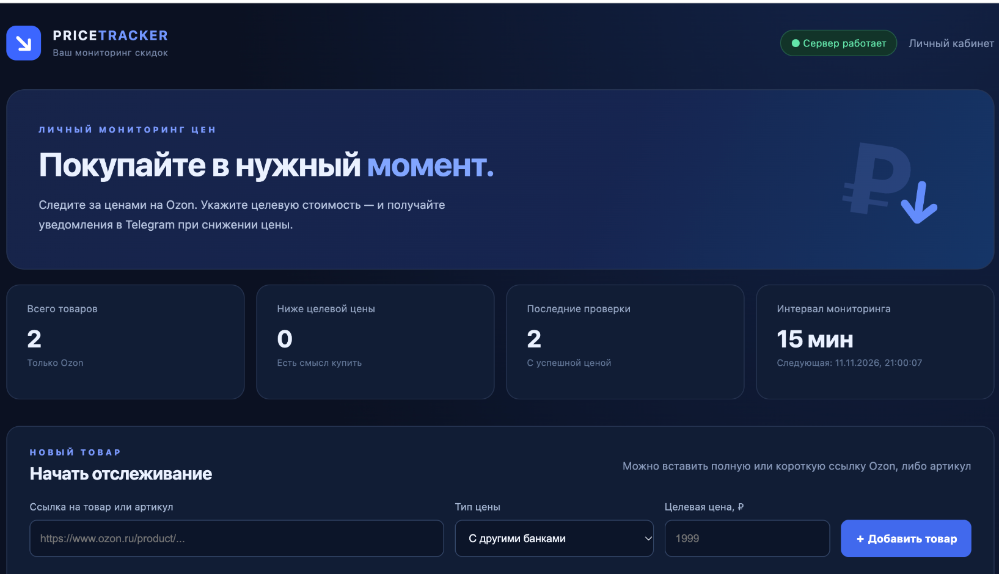
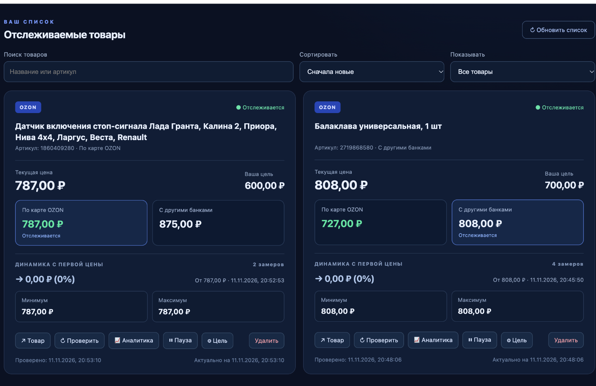
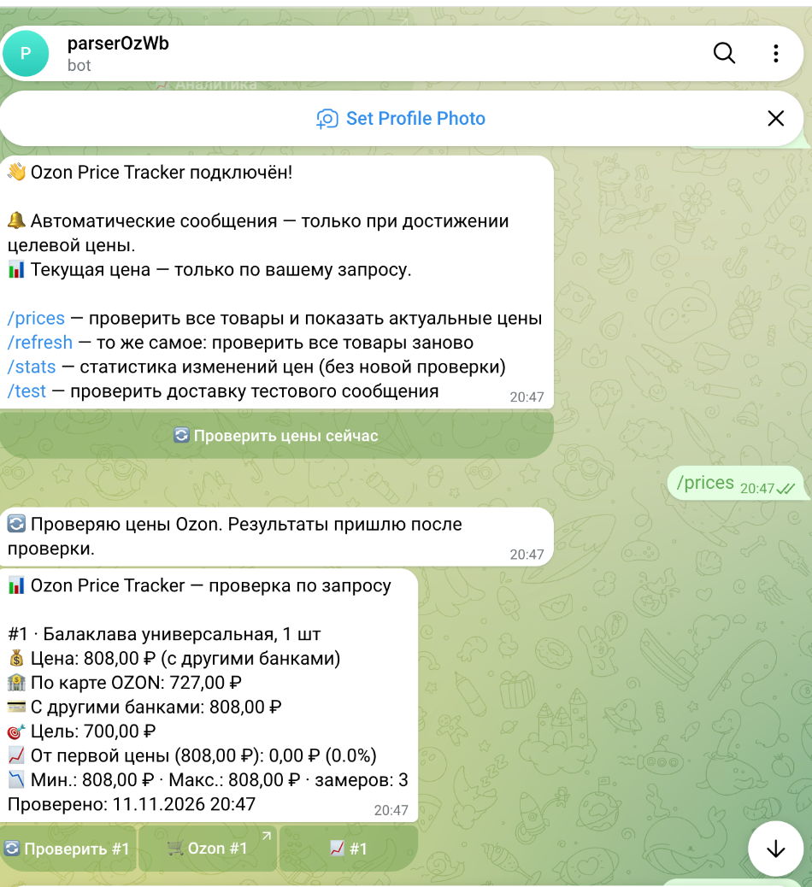

# Ozon Price Tracker

**Personal full-stack price monitoring application for Ozon, with history, analytics and Telegram alerts.**

[Русская версия / Russian README](README.md)



## Overview

Ozon Price Tracker is a personal web application built with **Python, FastAPI, Playwright, SQLite and JavaScript**. Users add an Ozon product link or SKU, select a price category and set a target amount. A scheduler checks prices periodically, records price history and sends a Telegram alert **only when a verified price reaches the target**.

The app uses publicly accessible buyer-facing product pages rather than seller APIs. Ozon may change its frontend responses or block automated requests; availability is not guaranteed.

## Key features

- Ozon product URLs, short `ozon.ru/t/...` links and SKUs.
- Separate tracking of Ozon card and other-bank prices when identifiable.
- Target price alerts, pause/resume, search and sorting.
- Price history, trend analysis, min/max prices and percentage changes.
- Telegram commands and on-demand checks, without unsolicited periodic summaries.
- Background jobs with APScheduler, SQLite storage and safe backups.



## Quick start (macOS)

Prerequisites: **Python 3.12+, macOS and Google Chrome**.

```bash
cd ~/Downloads
git clone https://github.com/Vlad-gw/parser_ozon_price.git ozon-price-tracker-pro
cd ozon-price-tracker-pro
bash setup.command
nano .env
```

Set `TELEGRAM_BOT_TOKEN` and `TELEGRAM_CHAT_ID` in `.env` (do not commit this file), then:

```bash
bash start.command
```

Visit **http://127.0.0.1:8000**. The startup script launches a separate Chrome browser profile for Ozon access; it can be minimized. The application runs while the Mac and browser are active.

## Tests

```bash
.venv/bin/pip install -r requirements-dev.txt
.venv/bin/python -m pytest -q
```

## Engineering notes

The architecture includes REST endpoints, SQLAlchemy models, price parsing with explicit uncertainty handling, scheduler-driven checks, Telegram alert state management and analytics. See [architecture](docs/ARCHITECTURE.md), [analytics methodology](docs/ANALYTICS.md) and [security notes](SECURITY.md).

> This is a personal MVP, not an official Ozon service. Buyer prices may vary with delivery region, account, product variant and promotions. The Linux/Xvfb startup is experimental; do not expose local ports or Chrome CDP publicly.


