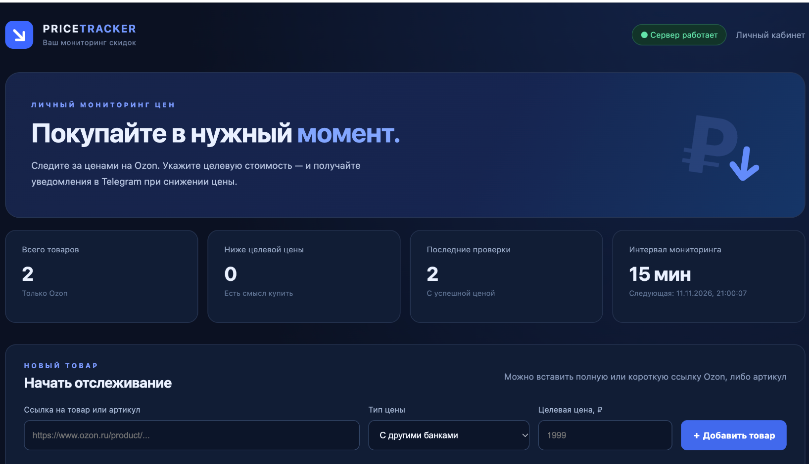
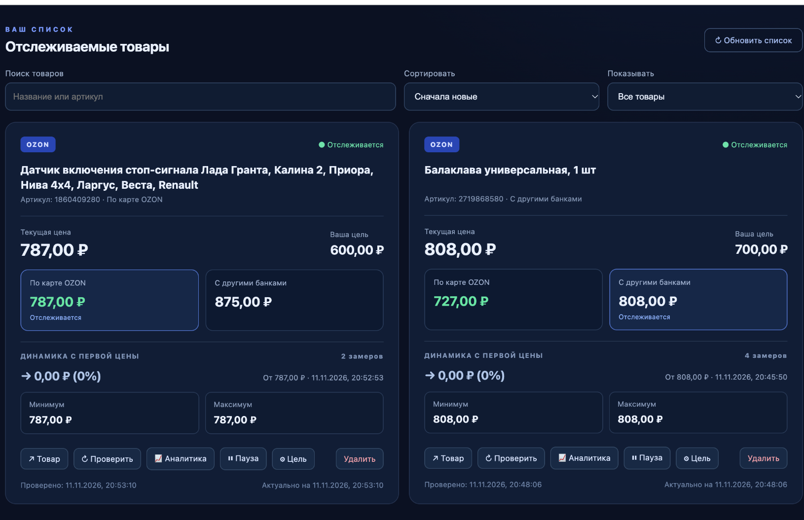
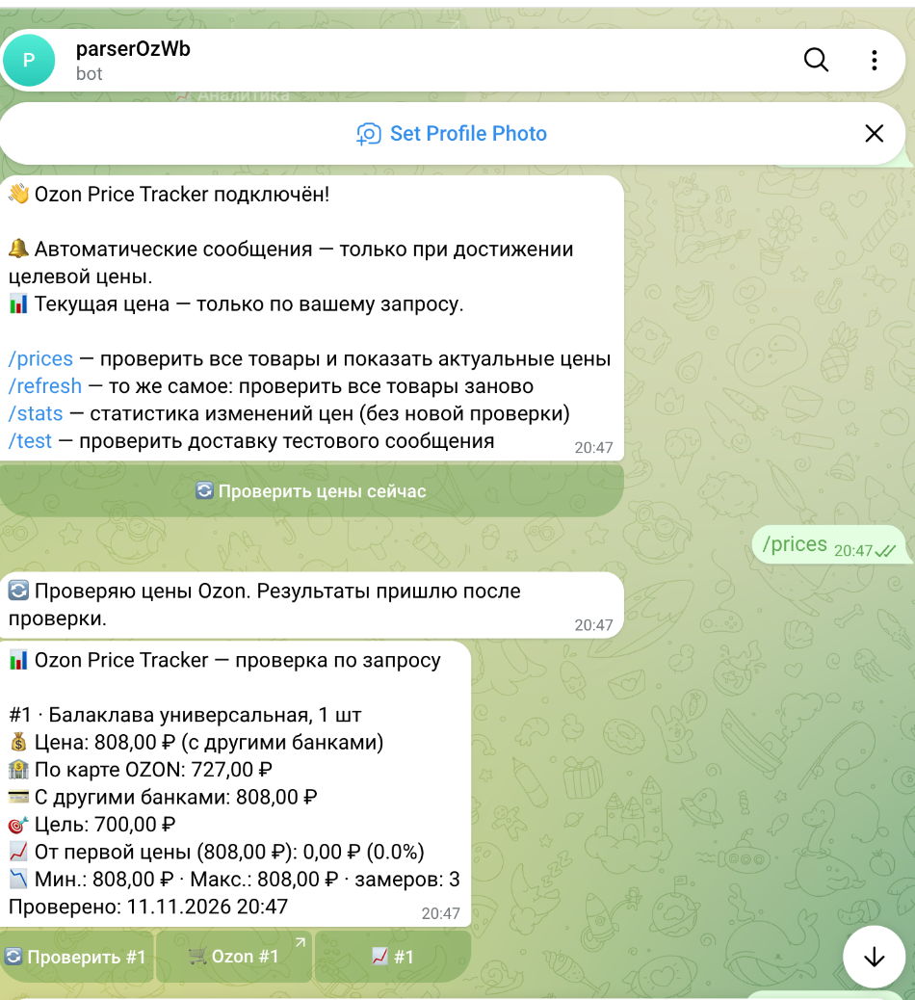
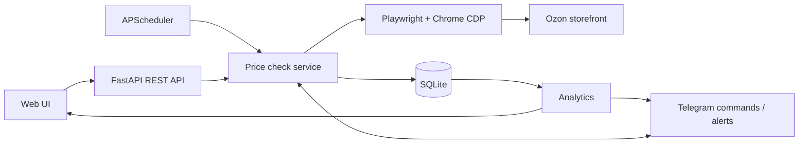

<div align="center">

# Ozon Price Tracker

**Мониторинг цен Ozon с аналитикой и Telegram-уведомлениями**

*Personal price monitoring dashboard for Ozon, with price history, analytics and Telegram alerts.*


[](https://github.com/Vlad-gw/parser_ozon_price/actions/workflows/tests.yml)

**[English README](README.en.md)** · **[Возможности](#-возможности) · [Скриншоты](#-интерфейс) · [Быстрый запуск](#-быстрый-запуск-на-macos) · [Архитектура](#-архитектура) · [Ограничения](#-важные-ограничения)**

</div>

---

## О проекте

**Ozon Price Tracker** — персональное full-stack веб-приложение, которое помогает следить за стоимостью товаров Ozon и не проверять цены вручную. Пользователь добавляет ссылку или артикул, выбирает тип цены и устанавливает желаемую сумму. Приложение проверяет карточку по расписанию, сохраняет историю и **отправляет Telegram-уведомление только при достижении целевого порога**.

Проект реализован как самостоятельный MVP: от получения данных с покупательской витрины до REST API, хранения истории, интерактивного интерфейса и Telegram-бота. **Seller API не используется**, поскольку приложение предназначено для покупателей, а не продавцов.



## ✨ Возможности

| Возможность | Реализация |
|---|---|
| 🔗 Добавление товара | Полная ссылка Ozon, короткая `ozon.ru/t/...` или артикул |
| 💳 Два типа цены | «По карте OZON» и «С другими банками», если данные однозначны |
| 🎯 Целевая стоимость | Индивидуальный порог и выбор отслеживаемого типа цены |
| 🔔 Уведомления | Только при подтверждённом достижении цели; без периодического спама |
| 🕒 Автопроверка | APScheduler, интервал настраивается (по умолчанию 15 минут) |
| 📈 История и аналитика | Изменение от первой цены, минимум/максимум, процентная динамика, графики |
| 🤖 Telegram-бот | Проверка цены по запросу, статистика и кнопка открытия товара |
| ⏸️ Управление | Пауза, возобновление, поиск, сортировка и удаление товаров |
| 🗃️ Надёжность данных | SQLite, сохранение событий уведомлений и резервные копии с учётом WAL |

## 📸 Интерфейс

### Мониторинг товаров и динамика цен

Отдельная карточка для каждого товара: две цены, целевой порог, статус последней проверки и изменение относительно первого успешного замера.



### Telegram: только нужные уведомления

Команда `/prices` запускает внеочередную проверку товаров, `/stats` показывает сохранённую аналитику. В обычном режиме бот молчит, пока цена не опустится до заданного значения.

<div align="center">
  
</div>

> Скриншоты показывают локальный MVP и цены на момент демонстрации. Текущая цена Ozon может отличаться.

## 🚀 Быстрый запуск на macOS

**Требования:** macOS, Python **3.12+**, установленный **Google Chrome**, доступ в интернет.

**1. Клонируйте проект в Загрузки:**

```bash
cd ~/Downloads
git clone https://github.com/Vlad-gw/parser_ozon_price.git ozon-price-tracker-pro
cd ozon-price-tracker-pro
```

Если проект уже скачан ZIP-архивом и распакован в `~/Downloads/ozon-price-tracker-pro`, достаточно перейти в эту папку.

**2. Установите зависимости и браузер:**

```bash
bash setup.command
```

Скрипт создаст `.venv`, установит `requirements.txt` и Playwright Chromium, а также скопирует `.env.example` в `.env` (если `.env` ещё нет).

**3. Настройте Telegram:**

```bash
nano .env
```

Укажите токен своего бота из **@BotFather** и числовой Chat ID. Перед использованием отправьте боту `/start`. Например:

```dotenv
TELEGRAM_BOT_TOKEN=YOUR_BOT_TOKEN
TELEGRAM_CHAT_ID=YOUR_CHAT_ID
CHECK_INTERVAL_MIN=15
TELEGRAM_POLLING_ENABLED=true
APP_TIMEZONE=Europe/Moscow
```

Сохранение в `nano`: **Ctrl+O → Enter → Ctrl+X**. Никогда не публикуйте `.env`.

**4. Запустите сервер:**

```bash
bash start.command
```

**5. Откройте веб-интерфейс:**

**http://127.0.0.1:8000**

При запуске на macOS создаётся **отдельный Chrome-профиль для парсера**. Он нужен для браузерной сессии, но не требует входа в ваш Google-аккаунт; служебное окно можно свернуть. Сам интерфейс можно открыть в обычном Chrome рядом с другими вкладками. Для остановки сервера нажмите **Ctrl+C**.

> Автопроверки выполняются, пока запущены сервер и браузер, а компьютер не спит.

## 🤖 Управление через Telegram

| Команда | Действие |
|---|---|
| `/start` | Подключение и список доступных команд |
| `/prices` | Новая проверка цен всех товаров |
| `/refresh` | Повторная проверка всех товаров |
| `/stats` | Аналитика по накопленным замерам (без запроса к Ozon) |
| `/test` | Тест доставки Telegram-сообщений |

**Логика уведомлений:** если пользователь установил цель **700 ₽**, бот не пишет при цене 850 ₽. Когда успешная проверка подтверждает **700 ₽ или ниже**, отправляется уведомление. Повторные сообщения о том же периоде снижения подавляются. После подтверждённого повышения выше цели и нового снижения уведомление может прийти снова.

## 🧩 Архитектура



| Компонент | Технологии |
|---|---|
| Backend / REST API | Python, FastAPI, Pydantic |
| Работа с витриной Ozon | Playwright, Google Chrome CDP, HTTPX |
| Данные / миграции | SQLAlchemy, SQLite |
| Фоновые задачи | APScheduler, asyncio |
| Уведомления | Telegram Bot API |
| UI | HTML, CSS, vanilla JavaScript |
| Тесты | pytest, GitHub Actions |

Детали проектирования и компромиссы — в [документе об архитектуре](docs/ARCHITECTURE.md), методика статистики — в [описании аналитики](docs/ANALYTICS.md).

<details>
<summary><strong>Структура проекта</strong></summary>

```text
parser_ozon_price/
├── app/
│   ├── main.py              # FastAPI / REST API
│   ├── service.py           # Проверки и пороги уведомлений
│   ├── database.py          # Модели и миграции SQLite
│   ├── analytics.py         # Статистика и история
│   ├── telegram_bot.py      # Команды Telegram
│   ├── maintenance.py       # Плановые резервные копии
│   ├── parsers/             # Ссылки Ozon, браузер и парсер цен
│   └── static/              # HTML, CSS, JavaScript
├── docs/
│   ├── images/             # Скриншоты интерфейса
│   └── ARCHITECTURE.md
├── tests/                  # Автоматические тесты
├── setup.command           # Первоначальная установка на macOS
├── start.command           # Локальный запуск
├── backup.command          # Резервная копия SQLite
├── .env.example            # Шаблон настроек без секретов
└── requirements.txt
```

</details>

## ⚙️ Настройки и обслуживание

Основные параметры находятся в `.env`:

| Параметр | Назначение |
|---|---|
| `CHECK_INTERVAL_MIN=15` | Частота проверки, не меньше 15 минут |
| `TELEGRAM_BOT_TOKEN` / `TELEGRAM_CHAT_ID` | Уведомления и команды бота |
| `APP_TIMEZONE=Europe/Moscow` | Часовой пояс Telegram-сообщений |
| `TELEGRAM_POLLING_ENABLED=true` | Приём команд и кнопок |
| `BACKUP_INTERVAL_HOURS=24` | Автоматическая резервная копия SQLite |
| `APP_PASSWORD` | Пароль HTTP Basic для защищённого внешнего доступа |

Ручная резервная копия действующей базы:

```bash
bash backup.command
```

Проверка тестов (не требует реальных запросов к Ozon):

```bash
.venv/bin/pip install -r requirements-dev.txt
.venv/bin/python -m pytest -q
```

## ⚠️ Важные ограничения

- **Нестабильный внешний источник.** Ozon не предоставляет этому проекту гарантированный публичный покупательский API. Витрина, внутренние JSON-ответы и антибот-защита могут измениться. Ошибка 403 не считается новой ценой.
- **Цена зависит от контекста.** Регион доставки, авторизация, банковские акции и вариации товара могут влиять на стоимость. Если тип скидки нельзя доказать, приложение не использует такую цену для автоматического сигнала.
- **Локальный MVP.** Скрипты `setup.command` и `start.command` рассчитаны на macOS. Linux/Xvfb — экспериментальная основа, а не проверенное production-развёртывание.
- **Безопасность.** По умолчанию приложение слушает только `127.0.0.1`; перед переносом на VPS обязательны HTTPS, авторизация, ограничение доступа к CDP и дополнительное тестирование. Подробнее — [SECURITY.md](SECURITY.md).

## 💼 Что демонстрирует проект

В этом проекте показан полный цикл разработки прикладного продукта: проектирование REST API и моделей данных, обработка внешних источников с частичными ошибками, планирование фоновых задач, состояние уведомлений, аналитика временных рядов и разработка веб-интерфейса без тяжёлого frontend-фреймворка.

Разработку можно продолжить в направлении централизованных журналов, более строгой авторизации для VPS и независимого сервиса браузерного сбора цен.

---

<div align="center">

**Personal full-stack project · Python · FastAPI · Playwright · SQLite · Telegram**

Разработан как независимый учебно-практический проект. Не является официальным сервисом Ozon и не связан с маркетплейсом.

</div>
