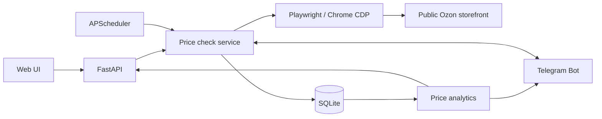

# Архитектура Ozon Price Tracker

> Документ отражает реализованный MVP, а не обещание production-ready сервиса.

## Компоненты

- **FastAPI** (`app/main.py`) — REST API и статический интерфейс. Запись товара и ручная проверка запускают сервис проверки.
- **Service layer** (`app/service.py`) — проверка товара, сохранение цен в целых копейках, сравнение с порогом, события Telegram-уведомлений.
- **Ozon parser** (`app/parsers/`) — распознавание артикула/URL, коротких ссылок, чтение покупательской страницы через Chrome/Playwright; внутренние JSON-данные и HTML могут изменяться.
- **SQLite** (`app/database.py`) — товары, обе серии цен, замеры, события уведомлений.
- **APScheduler** — периодический запуск проверок, backup.
- **Telegram** (`app/telegram_bot.py`) — long polling, команды, кнопки и уведомления при достижении цели.
- **Analytics** (`app/analytics.py`) — изменение относительно первого замера, минимумы/максимумы и ориентировочная средняя по времени.

## Принципы и компромиссы

1. **Разделение цен.** Стоимость по карте Ozon и стоимость с другими банками различаются только там, где источник позволяет их достоверно классифицировать. Неподтверждённая цена не создаёт автоматического сигнала.
2. **Никаких ложных нулей.** HTTP 403, CAPTCHA или невозможность прочитать карточку фиксируются как ошибки проверки. Последняя известная цена может показываться с явной датой.
3. **Одно приложение для личного использования.** SQLite и один процесс FastAPI достаточны для MVP, но запуск нескольких работников Uvicorn без выноса планировщика/бота вызовет конкурирующие фоновые задания.
4. **Согласованный backup.** SQLite Backup API корректно учитывает WAL при работающем приложении.
5. **Зависимость от сайта.** Внутренние JSON-ответы Ozon и антибот-правила не являются публичным стабильным API, поэтому доступность требует регулярного контроля.

## Безопасность

Секреты Telegram хранятся только в `.env` локально (не в Git). По умолчанию сервер доступен на `127.0.0.1`; при публикации нужен `APP_PASSWORD`, HTTPS и reverse proxy. Порт Chrome CDP нельзя открывать наружу.

## Тестирование

Тесты из `tests/` проверяют API, состояние БД, обновления цен, Telegram и аналитические расчёты без реальных запросов к маркетплейсу. Живые интеграционные проверки Ozon выполняются отдельно локально из-за нестабильности внешнего сайта.
